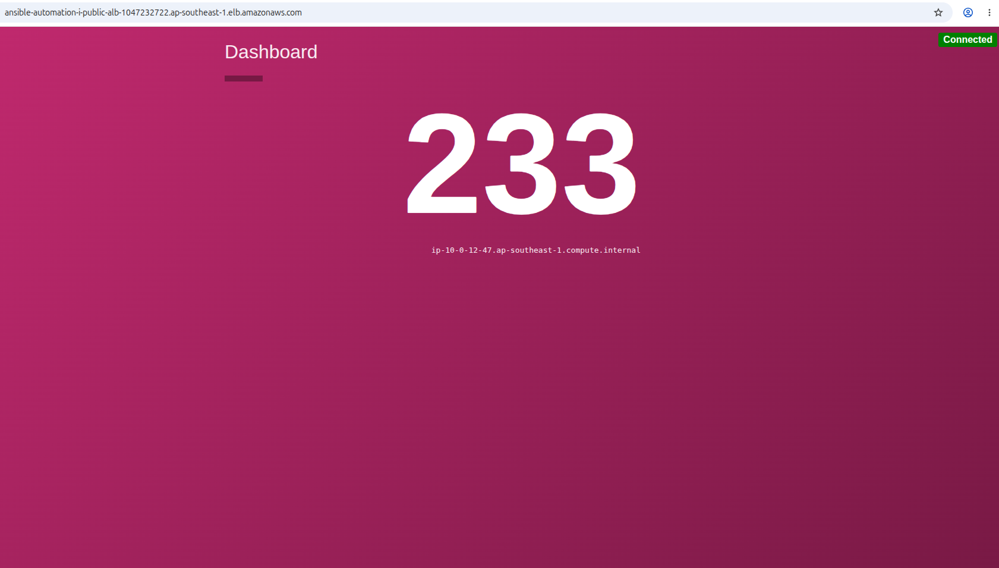

# Ansible Automation Infrastructure

An infrastructure automation project with two implementations: a local
Vagrant and VirtualBox lab, and an AWS environment provisioned with Terraform
and configured with Ansible. The AWS implementation separates public entry
points from private application instances and demonstrates automated service
deployment and application-to-application communication.

This repository is a learning and demonstration project; it is not presented
as a production deployment.

## Project overview

Infrastructure as Code describes infrastructure in version-controlled
configuration. Terraform provisions the AWS network and compute resources;
Ansible prepares and deploys the applications on EC2. Vagrant provides the
original local virtual-machine environment, configured by Ansible.

## Version history

| Version | Implementation |
| --- | --- |
| [v1.0.0](https://github.com/saiwaiyan09/ansible-automation-infra/releases/tag/v1.0.0) | Local Ubuntu 24.04 virtual machines managed by Vagrant and VirtualBox, with Ansible configuring Dashboard and Counting services. |
| [v2.0.0](https://github.com/saiwaiyan09/ansible-automation-infra/releases/tag/v2.0.0) | AWS infrastructure defined with Terraform; Amazon Linux 2023 EC2 instances and Dashboard/Counting applications configured with Ansible. Includes public and internal HTTP Application Load Balancers. |

See [the GitHub releases page](https://github.com/saiwaiyan09/ansible-automation-infra/releases)
for published release notes.

## Technology stack

- **Terraform** and the AWS provider for AWS resource provisioning
- **Amazon VPC** networking, EC2, security groups, route tables, Internet
  Gateway, NAT Gateways, and Application Load Balancers
- **Ansible** inventories, playbooks, and Jinja2 systemd unit templates
- **Amazon Linux 2023** for AWS EC2 instances
- **Vagrant**, **VirtualBox**, and **Ubuntu 24.04** for the local lab
- **systemd** for application service management
- HashiCorp demo Dashboard and Counting services

## AWS architecture

Terraform defines a custom VPC with public and private subnets across two
Availability Zones. An Internet Gateway provides the public route; a NAT
Gateway in each public subnet provides outbound access for its corresponding
private subnet.

The public Application Load Balancer spans the public subnets and accepts
HTTP traffic on port 80. It routes requests to the Dashboard EC2 instance on
port 9002 in a private subnet. The Dashboard calls the internal Application
Load Balancer on port 9002; that load balancer forwards to the Counting EC2
instance on port 9003. The application instances do not receive public IP
addresses.

The Ansible Controller EC2 instance is placed in a public subnet so an
administrator can connect to it and it can reach the private application
instances over SSH. SSH access to the controller is restricted by a
configurable source CIDR. The Terraform configuration creates the controller
instance but does not install or configure Ansible on it.

Both load balancers use HTTP listeners. HTTPS/TLS termination is not
implemented in this project.

### Infrastructure Diagram


The diagram is a visual overview. For exact subnet placement and listener
configuration, refer to the Terraform source: the public ALB listens on HTTP
port 80 and spans both public subnets.

### Terraform components

The Terraform configuration in [`aws/terraform/`](aws/terraform/) defines:

- A VPC, two public subnets, two private subnets, and their route tables
- An Internet Gateway, two NAT Gateways, and NAT Elastic IP addresses
- Security groups and ingress/egress rules for the controller, load balancers,
  and application instances
- Amazon Linux 2023 EC2 instances for the Ansible Controller, Dashboard, and
  Counting
- An internet-facing public ALB and a private internal ALB, HTTP listeners,
  target groups, health checks, and instance target attachments
- Outputs for resource identifiers, instance addresses, ALB DNS names, and
  the Dashboard URL

The source directory does not include Terraform state. Reconnect Terraform to
the correct state backend before considering any operation against existing
AWS infrastructure. See [AWS documentation](aws/README.md) for the safety
notes and workflow.

## Ansible automation workflow

The AWS playbooks in [`aws/ansible/playbooks/`](aws/ansible/playbooks/) separate
preparation from application deployment:

1. `prepare.yml` installs the required packages on the application instances.
2. `deploy.yml` downloads and installs the Dashboard and Counting binaries,
   places the systemd unit templates, and enables and starts the services.
3. `site.yml` is a basic connectivity/playbook check that reports managed
   hostnames.

The example inventory and group variables are in
[`aws/ansible/inventory.ini.example`](aws/ansible/inventory.ini.example) and
[`aws/ansible/group_vars/all.yml.example`](aws/ansible/group_vars/all.yml.example).
Use Terraform outputs for real private IP addresses and the internal ALB DNS
name. See [AWS documentation](aws/README.md) for configuration and execution
details.

## Application demonstration

The screenshot shows the Dashboard reached through the public AWS ALB DNS
name. The displayed connected state and counter demonstrate that the browser
established its WebSocket connection, the Dashboard received counter
information from Counting, and the Dashboard-to-Counting request traversed
the internal ALB.



## Repository structure

```text
.
├── aws/
│   ├── ansible/
│   │   ├── group_vars/all.yml.example
│   │   ├── inventory.ini.example
│   │   └── playbooks/
│   │       ├── deploy.yml
│   │       ├── prepare.yml
│   │       ├── site.yml
│   │       └── templates/
│   ├── assets/
│   │   └── dashboard-result.png
│   └── terraform/
│       ├── instances.tf
│       ├── internal-alb.tf
│       ├── internet-gateway.tf
│       ├── nat.tf
│       ├── outputs.tf
│       ├── private-route-tables.tf
│       ├── public-alb.tf
│       ├── public-route-tables.tf
│       ├── security.tf
│       ├── subnets.tf
│       ├── variables.tf
│       ├── versions.tf
│       └── vpc.tf
└── vagrant/
    ├── assets/
    ├── inventories/hosts.ini
    ├── playbooks/
    │   ├── site.yml
    │   └── templates/
    └── Vagrantfile
```

## Getting started

### AWS implementation

Prerequisites include an AWS account and CLI configuration, Terraform 1.9 or
later, Ansible, and SSH access to the controller and managed EC2 instances.
Configure AWS variables, key pair names, SSH source CIDR, inventory, and
application variables for your environment before use.

The AWS Terraform directory is source-only and has no state file or backend
configuration checked in. Do not apply it to existing infrastructure until it
is connected to the correct Terraform backend and state. An unconnected
working copy can treat existing resources as unmanaged and risk creating
duplicates or changing resources. Review [AWS documentation](aws/README.md)
before proceeding.

To run Ansible from an appropriately prepared controller, first run the
playbooks' syntax checks, then execute preparation and deployment:

```bash
cd aws/ansible
ansible-playbook -i inventory.ini playbooks/prepare.yml --syntax-check
ansible-playbook -i inventory.ini playbooks/deploy.yml --syntax-check
ansible-playbook -i inventory.ini playbooks/prepare.yml
ansible-playbook -i inventory.ini playbooks/deploy.yml
```

These execution commands assume the inventory and group variables have been
configured and the SSH agent is available to Ansible. For the full workflow,
including agent forwarding and validation, see
[`aws/README.md`](aws/README.md).

### Local Vagrant implementation

Install Vagrant, VirtualBox, and Ansible. Read
[`vagrant/README.md`](vagrant/README.md) for SSH public-key configuration,
VM startup, and the original Ansible playbook workflow. The local Vagrant lab
is independent of the AWS implementation.

## Security considerations

- Never commit AWS credentials, Terraform state, private SSH keys, local
  environment files containing secrets, or other sensitive values.
- Restrict the controller's SSH source CIDR to the administrator's trusted
  public IP range; avoid broad ranges such as `0.0.0.0/0`.
- Use SSH agent forwarding for the controller-to-instance Ansible workflow.
  Do not copy private keys onto the controller.
- The public ALB is configured for HTTP, not HTTPS. Do not send sensitive
  information through the demo endpoint.
- Review AWS resource costs before provisioning. NAT Gateways, load balancers,
  and EC2 instances can incur charges.
- Keep Terraform state in the correct protected backend and verify the
  selected workspace/state before planning or applying changes.

## Future improvements

- Add HTTPS with managed certificates and redirect HTTP to HTTPS.
- Add remote Terraform state with locking and documented environment
  separation.
- Add automated validation for Terraform, Ansible, and Markdown changes.
- Improve operational observability with centralized logs, metrics, and
  application health checks.
- Evaluate least-privilege IAM policies, high availability, and cost controls
  for an explicitly defined deployment environment.

## Releases

- [All GitHub releases](https://github.com/saiwaiyan09/ansible-automation-infra/releases)
- [v1.0.0](https://github.com/saiwaiyan09/ansible-automation-infra/releases/tag/v1.0.0)
- [v2.0.0](https://github.com/saiwaiyan09/ansible-automation-infra/releases/tag/v2.0.0)
